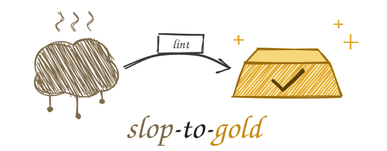
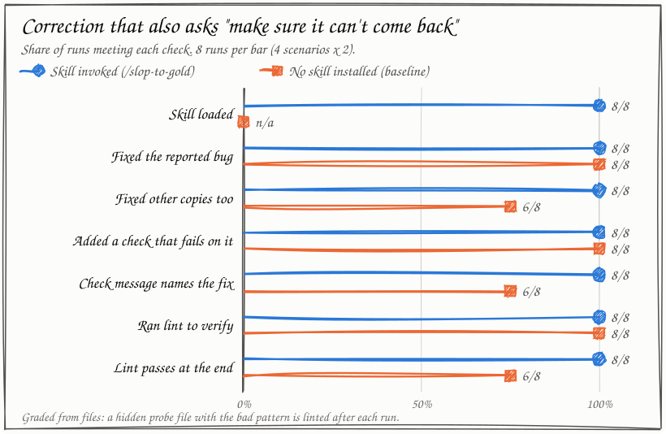
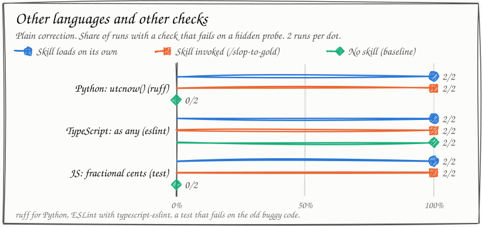
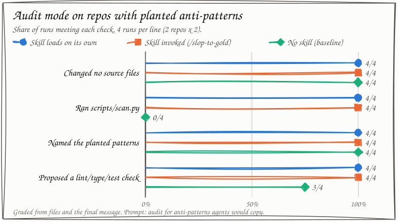
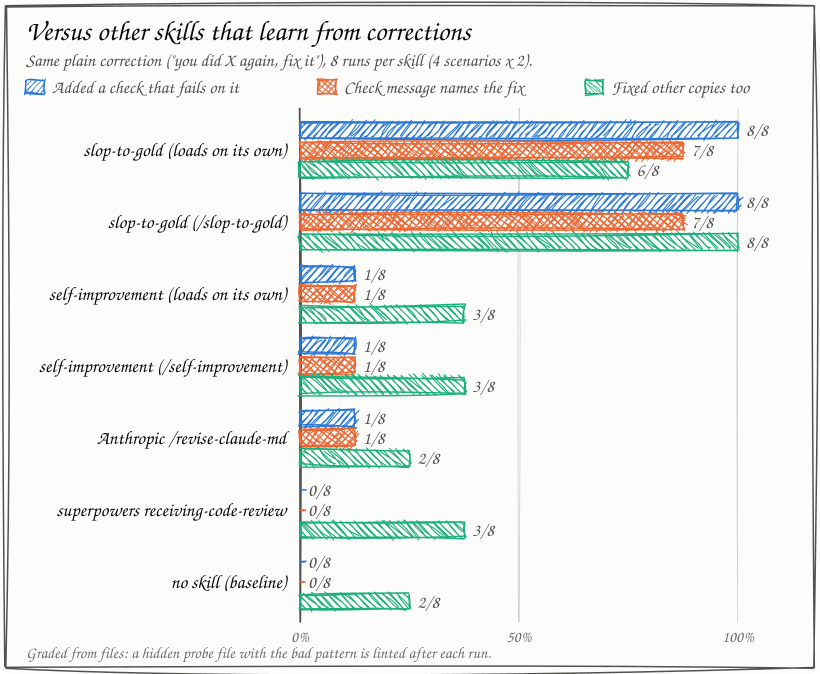
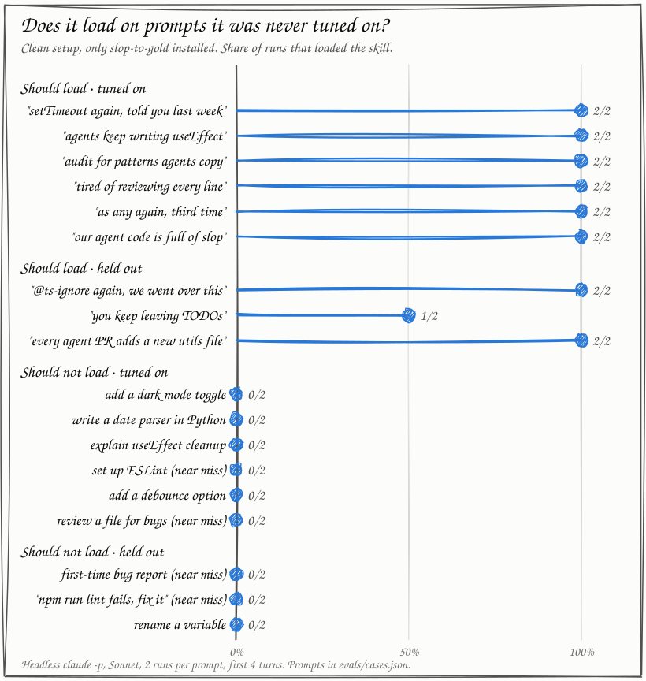

<p align="center"></p>

<h3 align="center">Every correction you give an agent becomes a check it can't skip.</h3>

<p align="center">
A <a href="https://docs.claude.com/en/docs/claude-code/skills">Claude Code skill</a> that turns repeated agent mistakes into lint rules, types and tests,<br>so the same AI slop can't come back.
</p>

<p align="center"><a href="https://github.com/DevxD98/slop-to-gold/actions/workflows/tests.yml"></a></p>

<p align="center">
<a href="#install">Install</a> ·
<a href="#what-it-looks-like">What it looks like</a> ·
<a href="#what-it-does">What it does</a> ·
<a href="#testing">Results</a> ·
<a href="#inspiration">Inspiration</a>
</p>

<p align="center"></p>

Agents copy whatever the codebase already shows them, so slop spreads. Telling the agent "don't do that" works until the next session forgets. This skill makes the codebase the strongest input instead: when you correct an agent, the fix becomes a lint rule, type, test or dependency boundary first. Prose (AGENTS.md, CLAUDE.md, comments) is the last resort.

**Does it work?** After a plain "you did X again, fix it", Claude with this skill left a lint rule that catches the mistake in 8 of 8 test runs. Without it: 0 of 8. In a clean head-to-head, three other popular correction-learning skills managed 0 of 8. [See the evals](#testing).

Inspired by the talk ["slop into gold"](https://youtu.be/O_zcc6Xl12g). See [Inspiration](#inspiration).

## Install

**Let Claude do it.** Paste this into Claude Code:

```text
Install the slop-to-gold skill for me. Run this in the shell:
  claude plugin install slop-to-gold --marketplace DevxD98/slop-to-gold
If that fails because this Claude Code version doesn't support --marketplace, run:
  claude plugin marketplace add DevxD98/slop-to-gold
  claude plugin install slop-to-gold@slop-to-gold
If the plugin commands don't exist at all, clone
https://github.com/DevxD98/slop-to-gold into ~/.claude/skills/slop-to-gold instead.
Then tell me whether it worked and remind me to restart Claude Code.
```

**Or run it yourself:**

```bash
claude plugin install slop-to-gold --marketplace DevxD98/slop-to-gold
```

Inside a Claude Code session the same thing is `/plugin marketplace add DevxD98/slop-to-gold`, then `/plugin install slop-to-gold@slop-to-gold`.

**Or as a plain skill folder**, without the plugin system:

```bash
git clone https://github.com/DevxD98/slop-to-gold.git ~/.claude/skills/slop-to-gold
```

Restart Claude Code afterwards. The plugin version shows up as `slop-to-gold:slop-to-gold`, the folder version as `slop-to-gold`. Install one, not both. The audit script needs `python3`; the optional hook below also needs `bash`, `jq` and `npm`.

## What it looks like

This is a real run from the evals below, unedited. The user says only this:

> You set innerHTML with user data in src/list.js again. That's an XSS hole and I've told you before. Fix it.

**Without the skill**, Claude fixes the one line and stops. `src/toast.js` still has the same bug, and nothing stops the next session writing it again:

```diff
-    li.innerHTML = item.name;
+    li.textContent = item.name;
```

**With the skill**, which loaded on its own, Claude fixes the line, finds and fixes the second copy in `src/toast.js`, and adds a lint rule whose message names the fix:

```diff
+const xssMessage =
+  "Raw HTML sinks cause XSS. Set `node.textContent = value` or build nodes with `el(tag, text)` from src/dom.js instead.";
+  {
+    rules: {
+      "no-restricted-properties": [
+        "error",
+        { property: "innerHTML", message: xssMessage },
+        { property: "outerHTML", message: xssMessage },
+        { property: "insertAdjacentHTML", message: xssMessage },
+      ],
```

Then the grader drops a new file with the same mistake into the project and runs lint. With the skill's rule:

```text
src/zz-probe.js
  2:3  error  'innerHTML' is restricted from being used. Raw HTML sinks cause XSS.
              Set `node.textContent = value` or build nodes with `el(tag, text)` from src/dom.js instead
✖ 1 problem (1 error, 0 warnings)
```

Without it, lint passes (exit 0) and the bug ships.

## What it does

| Mode | Triggers when | Does |
|---|---|---|
| Correction to check | You correct the agent, or the same mistake happens twice | Picks the strongest check, writes a lint message that teaches the root-cause fix, proves the check fails on the bad pattern, offers to clean up old occurrences |
| Audit | You ask to audit a repo, or start on an unfamiliar one | Runs `scripts/scan.py` for anti-pattern counts, then proposes a ranked list of checks. It changes nothing until you pick |

## Optional: enforcement hook

A skill is advice and can be skipped. The hook enforces it by running the project's own `lint` and `typecheck` scripts after every edit, and feeding failures back to Claude (exit code 2).

Add to `~/.claude/settings.json`, merging into your existing `hooks.PostToolUse` array:

```json
{
  "matcher": "Edit|Write|MultiEdit",
  "hooks": [
    {
      "type": "command",
      "command": "bash \"$HOME/.claude/skills/slop-to-gold/scripts/post-edit-check.sh\"",
      "timeout": 90,
      "statusMessage": "Checking lint/typecheck..."
    }
  ]
}
```

It stays silent unless all of these hold: the edited file is JS/TS, a `package.json` exists above it, `node_modules` is installed, and `package.json` defines a `lint` and/or `typecheck` script.

**Cost:** it runs the whole project lint after every edit (60s cap per script), which can be slow on large repos. To disable it, delete the entry.

## Inspiration

This skill is an independent adaptation of ideas from the talk **"slop into gold"**: https://youtu.be/O_zcc6Xl12g

Ideas taken from the talk:
- A trust pyramid: code design first, then lint/types/tests, then verification, with prose last.
- Every correction becomes a deterministic check.
- The codebase is a garden agents copy from, so remove bad examples and ban nuanced APIs.
- Lint error messages should teach the root-cause fix.
- Avoid justification comments.

Added here, not from the talk: packaging as a single skill with two modes, the `scan.py` audit script, the PostToolUse hook, and the testing notes. Any mistakes in the adaptation are mine, not the speaker's. All credit for the underlying thinking goes to the talk.

## Testing

A skill is a prompt, so "does it work" is several questions, and each needs its own kind of test. Everything below uses the current skill. Evals run headless `claude -p` (Sonnet) in a clean setup: `--setting-sources project,local` hides all other skills and plugins, the skill under test is copied into the project, and the baseline has no skill at all.

| Question | Test | Result |
|---|---|---|
| Is the package well formed? | Static checks (`tests/test_static.py`): frontmatter, trigger-only description, body under 500 words, links resolve | 6/6 pass |
| Does the scan script count right? | Unit tests (`tests/test_scan.py`): exact counts on a fixture, skipped folders, duplicates | 6/6 pass |
| Does the hook behave? | Contract tests (`tests/test_hook.sh`): 14 cases, including lint fail, typecheck fail, timeout, odd paths | 14/14 pass |
| Do the tests keep passing? | CI: all three suites run on every push (badge above) | passing |
| Does it load at the right time? | Trigger evals: 12 tuned and 6 held-out prompts, 2 runs each | loaded in 12/12 tuned and 5/6 held-out runs where it should, 0/18 where it shouldn't |
| Does it change what Claude does? | Correction evals: 4 JS scenarios x 2 runs per arm | see below |
| Does it hold outside JS and ESLint? | Python with ruff, TypeScript, and a case where the right check is a test: 3 scenarios x 2 runs per arm | see below |
| Does audit mode work? | 2 fixture repos with planted anti-patterns, 2 runs per arm | see below |
| Is it better than similar skills? | Same corrections with 3 other correction-learning skills instead | see below |

Each correction scenario is a small project with a planted mistake and a plain correction from the user. After the run, a hidden probe file containing the bad pattern is checked with the project's own tool (ESLint, ruff, or a test run against the old buggy code). A run counts as "added a check" only if that check fails on the probe. No model grades another model.

### Plain correction


After "you did X again, fix it", the baseline fixes the reported line and stops: 0 of 8 runs added a check. With the skill, 8 of 8 did, whether it loaded on its own or was invoked with `/slop-to-gold`. All 8 lint messages name the fix, other copies of the mistake were fixed (8/8, against 2/8), and lint passed at the end. The skill costs more per run: about $0.10 at API prices, against $0.04.



When the user also says "make sure it can't come back", the baseline adds a check too (8/8). The skill still gives better messages (8/8 name the fix, against 6/8), fixes the other copies (8/8 against 6/8) and leaves lint passing more often (8/8 against 6/8).

### Other languages and other checks



- **Python:** `datetime.utcnow()` keeps coming back. With the skill, both runs in each arm added a ruff rule and fixed the second copy. Three of four used `banned-api` with a message pointing to `datetime.now(timezone.utc)`; one enabled the stock `DTZ003`. Baseline: 0/2, it fixed the line only.
- **TypeScript:** `as any`. Every run added a lint rule, including the baseline (2/2), but only the skill's rules named the fix (2/2 each, against 0/2). The baseline used a stock rule whose message says only "Unexpected any".
- **A test as the check:** fractional cents in an invoice total. With the skill, 2/2 per arm added a regression test that fails on the old code. Baseline: 0/2, it wrote no tests, and the second copy in `receipt.js` kept the bug.

### Audit mode



Prompt: "Audit this codebase for anti-patterns that coding agents would copy if they saw them." The two repos hold known numbers of `useEffect` derived-state hacks, `as any` casts, `setTimeout(..., 0)` hacks, empty `catch` blocks and TODO markers, plus a few legitimate uses as decoys. With the skill, 4/4 runs per arm ran `scripts/scan.py`, changed no files, named the planted patterns and proposed a deterministic check. Without it, the report quality was close: 0/4 ran the script, and 3/4 proposed a check. Audit mode mostly makes the scan repeatable here; the baseline was already a good auditor.

### Versus other skills that learn from corrections



The same plain correction was run with each of these installed instead: [self-improvement](https://github.com/pskoett/pskoett-ai-skills) (commit `878b0e4`), [/revise-claude-md](https://github.com/anthropics/claude-plugins-official/tree/main/plugins/claude-md-management) (commit `5cec671`), and [receiving-code-review](https://github.com/obra/superpowers) (superpowers 7.0.2). None added a check in any run (0/8 each), the same as no skill. They fix the reported line. `self-improvement` wrote notes to `.learnings/`, but a note doesn't fail a build.

### Does it load on prompts it was never tuned on?



The description was tuned on 12 prompts, so 6 more were written beforehand and never used for tuning. It loaded in 12/12 runs on the tuned prompts and 5/6 on the held-out ones, and in 0/18 where it shouldn't. The miss was "You keep leaving TODO comments instead of handling the error", which loaded in 1 of 2 runs.

### History

Round 1 showed two gaps: the skill sometimes picked a stock ESLint rule whose message teaches nothing (`no-console`), and it asked before fixing a second copy of a mistake, leaving lint failing. It also loaded on a plain repeat correction in only about half the runs. `references/correction-to-check.md` now asks for rules with custom messages and for fixing or allowlisting other copies at once, and the description names the "again" and "I told you" signals. Round 1 also left the tester's ~80 other skills installed, so everything was rerun in the clean setup above. The round-1 rows are kept in `evals/results/` (`behavior*.jsonl`, `trigger*.jsonl`, `rivals.jsonl`). The audit and other-language evals found nothing to fix in the skill. One script fix came out of them: `scan.py` now skips `.claude/`, so a project-installed skill doesn't count its own files.

### Limits

- Small samples: 2 runs per cell, 8 per chart line. Read the charts as direction, not precision.
- One model (Sonnet), hooks and MCP servers off, trigger runs capped at 4 turns.
- "Names the fix" is a keyword match on the check's message.
- The boundary scenario has one copy of the mistake, so "fixed other copies" passes trivially there.
- The test scenario passes if the agent's tests fail on the old code. It can't tell a good test from a narrow one.
- The audit grader checks keywords and counts nothing: it doesn't verify the numbers in the report.
- The other-language scenarios are 3 cases with 2 runs each, written by the skill's author.
- The explicit-correction runs were made once, after the last skill change. Round-2 runs cut off by an account usage limit were discarded and rerun.

Full tables: [`evals/results/summary.md`](evals/results/summary.md). Raw rows: `evals/results/*.jsonl`.

### Run the tests yourself

```bash
python3 tests/test_static.py
python3 tests/test_scan.py
bash tests/test_hook.sh

# Evals need Claude Code logged in and a folder with eslint@9, @eslint/js and globals installed.
# The other-language scenarios also need ruff on PATH (--bin) and typescript + typescript-eslint (--ts-modules).
python3 evals/run_evals.py clean --out clean.jsonl --work /tmp/s2g --eslint-modules <path>/node_modules
python3 evals/run_evals.py clean --variant explicit --out clean-explicit.jsonl --work /tmp/s2g --eslint-modules <path>/node_modules
python3 evals/run_evals.py clean-trigger --out clean-trigger.jsonl --work /tmp/s2g --eslint-modules <path>/node_modules
python3 evals/run_evals.py audit --out audit.jsonl --work /tmp/s2g --eslint-modules <path>/node_modules
python3 evals/run_evals.py lang --out lang.jsonl --work /tmp/s2g --eslint-modules <path>/node_modules \
  --ts-modules <path-ts>/node_modules --bin <venv>/bin
# Other skills for the head-to-head: pass --src name=<folder or command file>.

# Charts, logo and social preview are hand-drawn with rough.js.
(cd evals/charts && npm install)
python3 evals/make_charts.py
node evals/charts/logo.mjs && node evals/charts/social.mjs
```

All the eval runs together (266 sessions) would cost about $26 at API prices, going by the `total_cost_usd` that `claude -p` reports. They ran on a Claude subscription, so they used plan limits and were not billed.

## License

MIT
