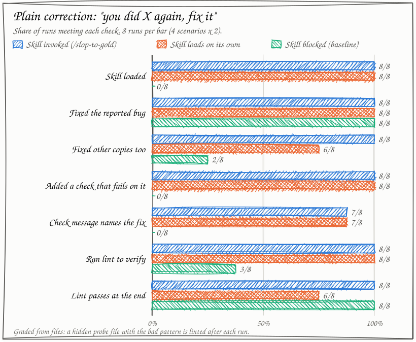

# slop-to-gold

A single [Claude Code skill](https://docs.claude.com/en/docs/claude-code/skills) that turns agent corrections into permanent, deterministic checks instead of prose rules.

Agents copy whatever the codebase already shows them, so slop spreads. This skill makes the codebase the strongest input: when you correct an agent, the fix becomes a lint rule, type, test or dependency boundary first. Prose (AGENTS.md, comments) is the last resort.

Inspired by the talk ["slop into gold"](https://youtu.be/O_zcc6Xl12g). See [Inspiration](#inspiration).

## What it does

| Mode | Triggers when | Does |
|---|---|---|
| Correction to check | You correct the agent, or the same mistake happens twice | Picks the strongest check, writes a lint message that teaches the root-cause fix, proves the check fails on the bad pattern, offers to clean up old occurrences |
| Audit | You ask to audit a repo, or start on an unfamiliar one | Runs `scripts/scan.py` for anti-pattern counts, then proposes a ranked list of checks. It changes nothing until you pick |

## Install

```bash
git clone https://github.com/DevxD98/-slop-to-gold.git ~/.claude/skills/slop-to-gold
```

Note: the repo name starts with a hyphen. If a command treats the URL or folder as a flag, put `--` before it or clone into the explicit path as above.

Requires `python3` for the scan. The optional hook also needs `bash`, `jq` and `npm`.

## Optional: enforcement hook

A skill is advice and can be skipped. The hook enforces it by running the project's own `lint` and `typecheck` scripts after every edit, and feeding failures back to Claude (exit code 2).

Add to `~/.claude/settings.json`, merging into your existing `hooks.PostToolUse` array:

```json
{
  "matcher": "Edit|Write|MultiEdit",
  "hooks": [
    {
      "type": "command",
      "command": "bash \"$HOME/.claude/skills/slop-to-gold/scripts/post-edit-check.sh\"",
      "timeout": 90,
      "statusMessage": "Checking lint/typecheck..."
    }
  ]
}
```

It stays silent unless all of these hold: the edited file is JS/TS, a `package.json` exists above it, `node_modules` is installed, and `package.json` defines a `lint` and/or `typecheck` script.

**Cost:** it runs the whole project lint after every edit (60s cap per script), which can be slow on large repos. To disable it, delete the entry.

## Inspiration

This skill is an independent adaptation of ideas from the talk **"slop into gold"**: https://youtu.be/O_zcc6Xl12g

Ideas taken from the talk:
- A trust pyramid: code design first, then lint/types/tests, then verification, with prose last.
- Every correction becomes a deterministic check.
- The codebase is a garden agents copy from, so remove bad examples and ban nuanced APIs.
- Lint error messages should teach the root-cause fix.
- Avoid justification comments.

Added here, not from the talk: packaging as a single skill with two modes, the `scan.py` audit script, the PostToolUse hook, and the testing notes. Any mistakes in the adaptation are mine, not the speaker's. All credit for the underlying thinking goes to the talk.

## Testing

A skill is a prompt, so "does it work" is really four questions. Each has its own kind of test:

| Question | Test type | How | Result |
|---|---|---|---|
| Is the package well formed? | Static checks | `tests/test_static.py`: frontmatter, "Use when" trigger-only description, body under 500 words, every referenced file exists, no personal paths | 6/6 pass |
| Do the scripts do what they say? | Unit tests | `tests/test_scan.py`: exact pattern counts on a fixture, skips `node_modules`/`dist`, dedups copied files, comment ratio, `--top` | 6/6 pass |
| Does the hook behave in every case? | Contract tests | `tests/test_hook.sh`: 14 cases covering pass, lint fail, typecheck fail, no `node_modules`, non-JS file, malformed JSON, paths with spaces, monorepo, timeout | 14/14 pass |
| Does Claude load it at the right time? | Trigger evals | 12 prompts (6 should load, 6 should not, including near misses) x 2 runs in headless `claude -p` | recall 10/12, false triggers 0/12 |
| Does it change what Claude does? | Behavior A/B evals | 4 correction scenarios x 3 arms x 2 runs, graded from the files each run left behind | see below |

### Does it change what Claude does?

Each scenario is a small JS project with a planted mistake (`setTimeout(..., 0)` render hacks, stray `console.log`, a renderer importing main-process code, `innerHTML` with user data) and a correction from the user. After each run, a hidden probe file containing the bad pattern is linted. A run only counts as "added a check" if that probe fails. No model grades another model.

Three arms: the skill invoked with `/slop-to-gold`, the skill installed but left to load on its own, and the skill blocked (`--disallowedTools "Skill(slop-to-gold)"`) as the baseline.



With a plain correction ("you did X again, fix it"), the baseline fixes the one line and stops: 0/8 runs added a check. With the skill, 8/8 added a lint rule that fails on the probe, 7/8 wrote a message naming the fix, and 8/8 also fixed the other copies of the mistake.


When the user also says "make sure it can't come back", the baseline already adds a check (8/8). The skill still improves the message (8/8 name the fix versus 6/8) and finishes cleaner (8/8 lint passing versus 7/8), at about the same cost ($0.16 versus $0.15 a run).

### When does it load on its own?


It loads for complaints about slop, recurring patterns, audits and trust, and never loaded for unrelated or near-miss tasks. **The weak spot is the plain one-off correction:** it loaded on 2 of 4 such trigger runs, and on 0 of 8 runs in the behavior evals, which is why the "auto" arm above matches the baseline. Until the description is tuned, type `/slop-to-gold` when you correct the agent, or install the hook.

### Limits of these numbers

- Small samples: 2 runs per cell. Read the bars as direction, not precision.
- One model (Sonnet via `claude -p`), hooks and MCP servers off, trigger runs capped at 4 turns.
- In the baseline arm the skill's name and description are still listed; only loading it is blocked.
- The boundary scenario has no second copy of the mistake, so "fixed other copies" passes trivially there.
- "Names the fix" is a keyword match on the lint message (for example `textContent` for `innerHTML`).

Full tables: [`evals/results/summary.md`](evals/results/summary.md). Raw rows: `evals/results/*.jsonl`.

### Run the tests yourself

```bash
python3 tests/test_static.py
python3 tests/test_scan.py
bash tests/test_hook.sh

# Evals: need Claude Code logged in, and a folder with eslint@9 and @eslint/js@9 installed.
python3 evals/run_evals.py trigger  --reps 2 --work /tmp/s2g --eslint-modules <path>/node_modules
python3 evals/run_evals.py behavior --reps 2 --work /tmp/s2g --eslint-modules <path>/node_modules
python3 evals/make_charts.py
```

The full eval run is 64 sessions and cost about $8 in API usage.

## License

MIT
