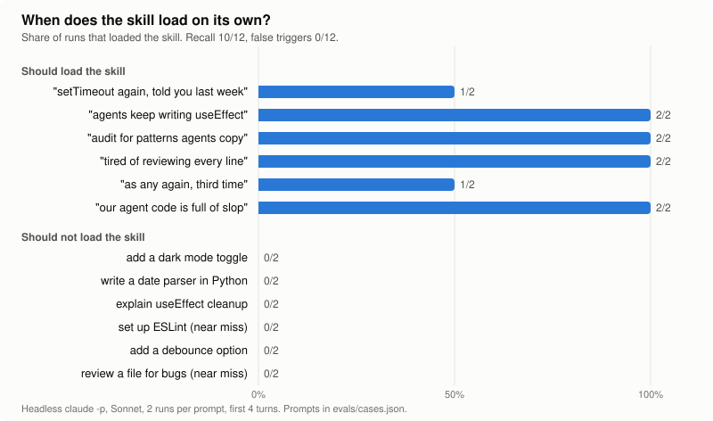

<p align="center"></p>

<h3 align="center">Every correction you give an agent becomes a check it can't skip.</h3>

<p align="center">
A <a href="https://docs.claude.com/en/docs/claude-code/skills">Claude Code skill</a> that turns repeated agent mistakes into lint rules, types and tests,<br>so the same AI slop can't come back.
</p>

<p align="center">
<a href="#install">Install</a> ·
<a href="#what-it-looks-like">What it looks like</a> ·
<a href="#what-it-does">What it does</a> ·
<a href="#testing">Results</a> ·
<a href="#inspiration">Inspiration</a>
</p>

<p align="center"></p>

Agents copy whatever the codebase already shows them, so slop spreads. Telling the agent "don't do that" works until the next session forgets. This skill makes the codebase the strongest input instead: when you correct an agent, the fix becomes a lint rule, type, test or dependency boundary first. Prose (AGENTS.md, CLAUDE.md, comments) is the last resort.

**Does it work?** After a plain "you did X again, fix it", Claude with this skill left a lint rule that catches the mistake in 8 of 8 test runs. Without it: 0 of 8. Three other popular correction-learning skills managed at most 1 of 8. [See the evals](#testing).

Inspired by the talk ["slop into gold"](https://youtu.be/O_zcc6Xl12g). See [Inspiration](#inspiration).

## Install

**Let Claude do it.** Paste this into Claude Code:

```text
Install the slop-to-gold skill for me. Run this in the shell:
  claude plugin install slop-to-gold --marketplace DevxD98/slop-to-gold
If that fails because this Claude Code version doesn't support --marketplace, run:
  claude plugin marketplace add DevxD98/slop-to-gold
  claude plugin install slop-to-gold@slop-to-gold
If the plugin commands don't exist at all, clone
https://github.com/DevxD98/slop-to-gold into ~/.claude/skills/slop-to-gold instead.
Then tell me whether it worked and remind me to restart Claude Code.
```

**Or run it yourself:**

```bash
claude plugin install slop-to-gold --marketplace DevxD98/slop-to-gold
```

Inside a Claude Code session the same thing is `/plugin marketplace add DevxD98/slop-to-gold`, then `/plugin install slop-to-gold@slop-to-gold`.

**Or as a plain skill folder**, without the plugin system:

```bash
git clone https://github.com/DevxD98/slop-to-gold.git ~/.claude/skills/slop-to-gold
```

Restart Claude Code afterwards. The plugin version shows up as `slop-to-gold:slop-to-gold`, the folder version as `slop-to-gold`. Install one, not both. The audit script needs `python3`; the optional hook below also needs `bash`, `jq` and `npm`.

## What it looks like

This is a real run from the evals below, unedited. The user says only this:

> You set innerHTML with user data in src/list.js again. That's an XSS hole and I've told you before. Fix it.

**Without the skill**, Claude fixes the one line and stops. `src/toast.js` still has the same bug, and nothing stops the next session writing it again:

```diff
-    li.innerHTML = item.name;
+    li.textContent = item.name;
```

**With the skill**, which loaded on its own, Claude fixes the line, finds and fixes the second copy in `src/toast.js`, and adds a lint rule whose message names the fix:

```diff
+const xssMessage =
+  "Raw HTML sinks cause XSS. Set `node.textContent = value` or build nodes with `el(tag, text)` from src/dom.js instead.";
+  {
+    rules: {
+      "no-restricted-properties": [
+        "error",
+        { property: "innerHTML", message: xssMessage },
+        { property: "outerHTML", message: xssMessage },
+        { property: "insertAdjacentHTML", message: xssMessage },
+      ],
```

Then the grader drops a new file with the same mistake into the project and runs lint. With the skill's rule:

```text
src/zz-probe.js
  2:3  error  'innerHTML' is restricted from being used. Raw HTML sinks cause XSS.
              Set `node.textContent = value` or build nodes with `el(tag, text)` from src/dom.js instead
✖ 1 problem (1 error, 0 warnings)
```

Without it, lint passes (exit 0) and the bug ships.

## What it does

| Mode | Triggers when | Does |
|---|---|---|
| Correction to check | You correct the agent, or the same mistake happens twice | Picks the strongest check, writes a lint message that teaches the root-cause fix, proves the check fails on the bad pattern, offers to clean up old occurrences |
| Audit | You ask to audit a repo, or start on an unfamiliar one | Runs `scripts/scan.py` for anti-pattern counts, then proposes a ranked list of checks. It changes nothing until you pick |

## Optional: enforcement hook

A skill is advice and can be skipped. The hook enforces it by running the project's own `lint` and `typecheck` scripts after every edit, and feeding failures back to Claude (exit code 2).

Add to `~/.claude/settings.json`, merging into your existing `hooks.PostToolUse` array:

```json
{
  "matcher": "Edit|Write|MultiEdit",
  "hooks": [
    {
      "type": "command",
      "command": "bash \"$HOME/.claude/skills/slop-to-gold/scripts/post-edit-check.sh\"",
      "timeout": 90,
      "statusMessage": "Checking lint/typecheck..."
    }
  ]
}
```

It stays silent unless all of these hold: the edited file is JS/TS, a `package.json` exists above it, `node_modules` is installed, and `package.json` defines a `lint` and/or `typecheck` script.

**Cost:** it runs the whole project lint after every edit (60s cap per script), which can be slow on large repos. To disable it, delete the entry.

## Inspiration

This skill is an independent adaptation of ideas from the talk **"slop into gold"**: https://youtu.be/O_zcc6Xl12g

Ideas taken from the talk:
- A trust pyramid: code design first, then lint/types/tests, then verification, with prose last.
- Every correction becomes a deterministic check.
- The codebase is a garden agents copy from, so remove bad examples and ban nuanced APIs.
- Lint error messages should teach the root-cause fix.
- Avoid justification comments.

Added here, not from the talk: packaging as a single skill with two modes, the `scan.py` audit script, the PostToolUse hook, and the testing notes. Any mistakes in the adaptation are mine, not the speaker's. All credit for the underlying thinking goes to the talk.

## Testing

A skill is a prompt, so "does it work" is really six questions. Each needs a different kind of test:

| Question | Test type | How | Result |
|---|---|---|---|
| Is the package well formed? | Static checks | `tests/test_static.py`: frontmatter, a description that only says when to use the skill, body under 500 words, every referenced file exists, no personal paths | 6/6 pass |
| Do the scripts do what they say? | Unit tests | `tests/test_scan.py`: exact pattern counts on a fixture, skips `node_modules` and `dist`, skips copied files, comment ratio, `--top` | 6/6 pass |
| Does the hook behave in every case? | Contract tests | `tests/test_hook.sh`: 14 cases covering pass, lint fail, typecheck fail, no `node_modules`, a non-JS file, malformed JSON, paths with spaces, a monorepo, a timeout | 14/14 pass |
| Does Claude load the skill at the right time? | Trigger evals | 12 prompts (6 should load it, 6 should not, including near misses) x 2 runs in headless `claude -p` | 12/12 loaded when they should, 0/12 when they shouldn't |
| Does it change what Claude does? | Behavior A/B evals | 4 correction scenarios x 3 arms x 2 runs, graded from the files each run left behind | see below |
| Is it better than the alternatives? | Head-to-head evals | Same scenarios with 3 other correction-learning skills in place of this one, 32 runs | 8/8 added a failing check, against at most 1/8 |

### Does it change what Claude does?

Each scenario is a small JS project with a planted mistake (`setTimeout(..., 0)` render hacks, a stray `console.log`, a renderer importing main-process code, `innerHTML` with user data) and a correction from the user. After each run, a hidden probe file containing the bad pattern is linted. A run only counts as "added a check" if lint fails on that probe. No model grades another model.

There are three arms. In the first, the user types `/slop-to-gold`. In the second, the skill is installed and has to load on its own. In the third, the skill is blocked with `--disallowedTools "Skill(slop-to-gold)"`, which gives the baseline.


With a plain correction ("you did X again, fix it"), the baseline fixes the one line and stops: none of its 8 runs added a check. With the skill, all 8 runs added a lint rule that fails on the probe, 7 of 8 wrote a lint message naming the fix, and all 8 ran lint to confirm it. That held whether the user typed `/slop-to-gold` or the skill loaded on its own.

The "fixed other copies" and "lint passes at the end" bars are 6/8 when the skill loads on its own, because of the `setTimeout` scenario. In both of those runs, the new rule flagged a second `setTimeout` hack in `tooltip.js`. The runs listed it and offered to fix it instead of editing a file nobody had mentioned. That's what the skill asks for, but it leaves lint failing until you say yes.


When the user also says "make sure it can't come back", Claude adds a check without the skill too (8/8). The skill still makes the lint message better: 8/8 messages name the fix, against 6/8 without it. It also finishes with lint passing more often (8/8 against 7/8), at about the same cost ($0.16 a run against $0.15).

### When does it load on its own?



The first description loaded the skill for complaints about slop, recurring patterns, audits and trust, but only half the time for a plain repeat correction like "you did X again, fix it". In the behavior runs it never loaded for one at all (0/8). The description now names those signals ("again", "I told you", "keeps happening", "third time") and says the skill applies even when the user only asks for a fix. With that change, it loaded in 12 of 12 trigger runs where it should and 8 of 8 behavior runs, and it still never loaded for unrelated or near-miss tasks.

### Versus other skills that learn from corrections

Other skills already try to stop repeat mistakes, so the same plain correction was run with each of them instead, with slop-to-gold blocked:

- [**self-improvement**](https://github.com/pskoett/pskoett-ai-skills) (pskoett, commit `878b0e4`): logs corrections to `.learnings/` and promotes them to `CLAUDE.md`.
- [**/revise-claude-md**](https://github.com/anthropics/claude-plugins-official/tree/main/plugins/claude-md-management) (Anthropic's `claude-md-management` plugin, commit `5cec671`): proposes `CLAUDE.md` additions from the session.
- [**receiving-code-review**](https://github.com/obra/superpowers) (superpowers 7.0.2): how to act on feedback rigorously.


All of them fix the reported line. None of them reliably leaves anything behind that stops the mistake coming back: at most 1 run in 8 added a check that fails on the probe, against 8 in 8 for slop-to-gold. `self-improvement`, when invoked, wrote a careful note in `.learnings/LEARNINGS.md` in 7 of 8 runs, but a note doesn't fail a build, and the probe file passed lint every time. `/revise-claude-md` drafts its `CLAUDE.md` diff and waits for approval, so in a headless run nothing was written. slop-to-gold uses about the same per run (an estimated $0.15 to $0.16 at API prices, against $0.11 to $0.17).

The gap slop-to-gold still has: when it loads on its own it asks before touching files you didn't mention, so "fixed other copies" is 6/8 rather than 8/8. That's deliberate.

### Limits of these numbers

- The samples are small: 2 runs per cell. Read the bars as direction, not precision.
- Everything ran on one model (Sonnet via `claude -p`), with hooks and MCP servers off. Trigger runs were capped at 4 turns.
- In the baseline arm the skill's name and description are still listed; only loading it is blocked.
- The boundary scenario has no second copy of the mistake, so "fixed other copies" passes trivially there.
- "Names the fix" is a keyword match on the lint message (for example `textContent` for `innerHTML`).
- The new description was tested on the same prompts it was written to fix. Prompts it hasn't seen may do worse.
- In the comparison runs slop-to-gold is still listed (only blocked), and Claude sometimes reached for it first, which may be why `self-improvement` never loaded on its own (0/8). The invoked rows avoid that and show the same result.
- The comparison runs were made on a different day from the slop-to-gold and baseline rows, on the same fixtures and prompts.

Full tables: [`evals/results/summary.md`](evals/results/summary.md). Raw rows: `evals/results/*.jsonl`.

### Run the tests yourself

```bash
python3 tests/test_static.py
python3 tests/test_scan.py
bash tests/test_hook.sh

# Evals need Claude Code logged in, plus a folder with eslint@9 and @eslint/js@9 installed.
python3 evals/run_evals.py trigger  --reps 2 --work /tmp/s2g --eslint-modules <path>/node_modules
python3 evals/run_evals.py behavior --reps 2 --work /tmp/s2g --eslint-modules <path>/node_modules
# Head-to-head: point --rival-src at a checkout of the other skill (see RIVALS in run_evals.py).
python3 evals/run_evals.py rival --rival self-improvement --rival-src <skill dir> --out rivals.jsonl --work /tmp/s2g --eslint-modules <path>/node_modules

# Charts, logo and social preview are hand-drawn with rough.js.
(cd evals/charts && npm install)
python3 evals/make_charts.py
node evals/charts/logo.mjs && node evals/charts/social.mjs
```

All the eval runs together (128 sessions) would cost about $16 at API prices, going by the `total_cost_usd` that `claude -p` reports for each run. They were run on a Claude subscription, so they used plan limits rather than being billed.

## License

MIT
